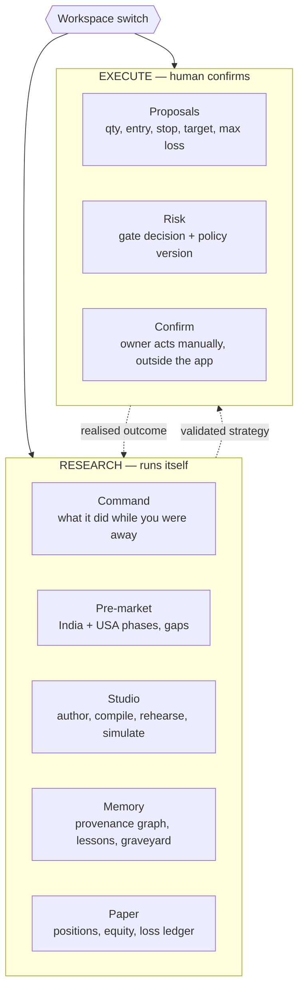
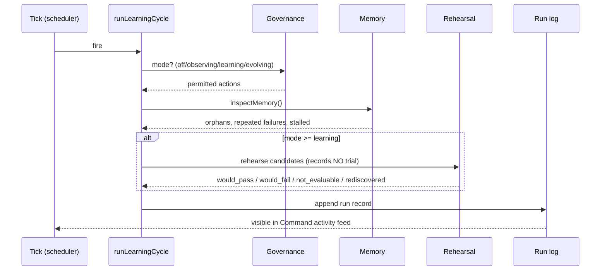
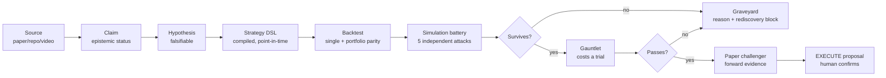
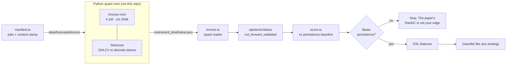
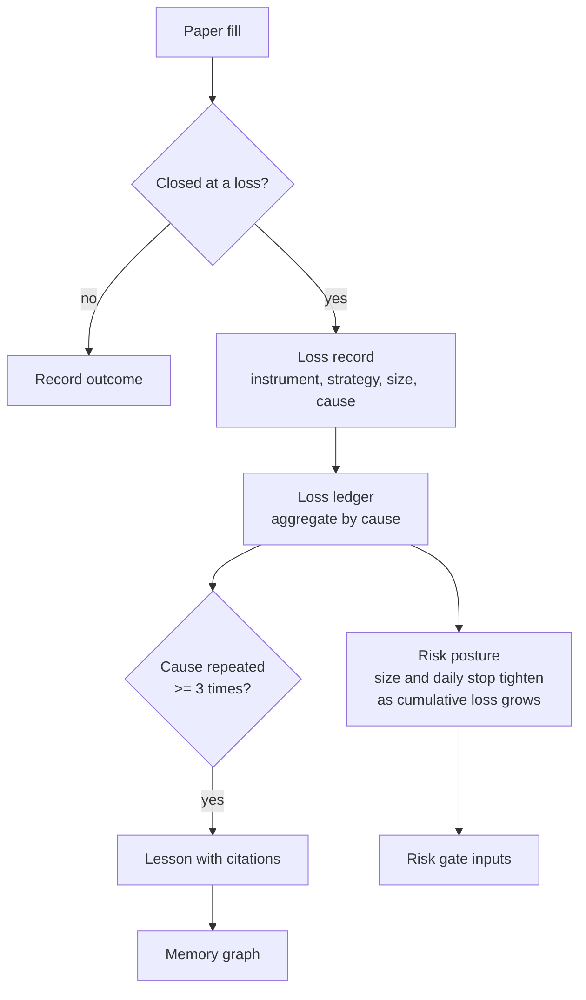
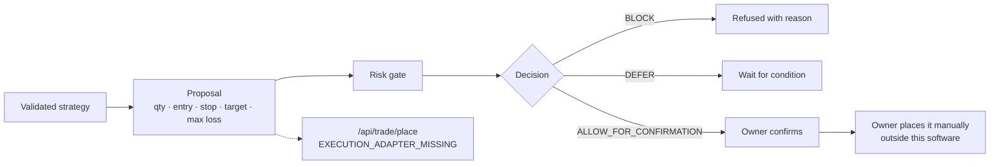

# MarketPulse OS — Architecture

Implements `docs/REQUIREMENTS.md`. Diagrams are Mermaid so they render in the repo and in any
artifact view.

---

## 1. The two workspaces

Scalping is a **mode of both**, not a third workspace: in RESEARCH it is a strategy family under
test; in EXECUTE it is a proposal with a tighter time budget.

---

## 2. Planes

| Plane | Owns | Key modules |
|---|---|---|
| **Control** | Claude via MCP; learning mode ladder; governance | `mcp/server.ts`, `lib/governance/**` |
| **Evidence/Data** | Quotes, candles, provenance, freshness | `lib/market/**`, `lib/providers/**`, `lib/ui/panel-state.ts` |
| **Research** | Sources, claims, hypotheses, memory graph | `lib/knowledge/**` |
| **Simulation** | Backtest engines, gauntlet, battery | `lib/backtest/**`, `lib/strategy/**`, `lib/simulation/**` |
| **Portfolio/Risk** | Paper accounting, risk gate, loss memory | `lib/paper/**`, `lib/risk/**` |
| **Confirmation** | Proposals; refuses to execute | `lib/execution/**` |

---

## 3. The autonomous loop

This is the part the owner says is invisible. It must produce a **durable, timestamped record**.

**Why a rehearsal and not the gauntlet:** `runGauntlet` consumes the sealed holdout budget and
every trial permanently raises that strategy's statistical bar. An idle loop running it on a
timer would destroy the only unbiased estimate the system has, unprompted and irreversibly.

---

## 4. Validation pipeline

| Stage | Guard | Module |
|---|---|---|
| Compile | Lookahead features rejected | `lib/strategy/dsl.ts` |
| Backtest | Decide-on-close, fill-next-open; engines kept at parity | `lib/backtest/` |
| Battery | Monte Carlo · block bootstrap · walk-forward · permutation · cost stress | `lib/simulation/battery.ts` |
| Graveyard | Compiler-independent identity blocks rediscovery | `lib/strategy/graveyard.ts` |
| Gauntlet | Deflated Sharpe, PBO, sealed holdout, family trial count | `lib/strategy/gauntlet.ts` |
| Risk | Independent, agent-immutable | `lib/paper/risk.ts` |

---

## 5. Simulation battery — what each attack catches

| Simulation | Null it tests | Catches |
|---|---|---|
| Monte Carlo | Trade order is irrelevant | Results resting on one sequence |
| Stationary block bootstrap | Serial dependence preserved | Clustered losses IID resampling destroys |
| Walk-forward | Edge is spread over time | One lucky stretch carrying a flat record |
| Sign-flip permutation | Outcomes are symmetric noise | Means reachable by luck |
| Cost stress | Costs were modelled optimistically | Edge thinner than the cost assumption |

Deterministic given a seed. A verdict that moves between runs cannot be evidence, because the
next run is a new trial.

---

## 6. Kronos integration

**Design rules.** The model never runs in this app — it is PyTorch and there is no model runtime
here by design. `lookbackBars` is clamped to the checkpoint's context window *at request time*,
because a 512-context model handed 2000 bars silently reads the last 512 and produces a forecast
that looks like four years of history and used ten months. `epistemicStatus` is stamped by the
reader, never read from the file, so a producer cannot promote its own standing.

---

## 7. Loss memory and adaptation

The adaptation is **deterministic and bounded**, not a model deciding to trade differently. The
owner's ceilings remain owner-set; adaptation may only tighten, never loosen.

---

## 8. Data honesty — the 14 states

Every panel resolves to exactly one. The pairs that matter render identically in a naive UI and
mean opposite things:

| Pair | Difference |
|---|---|
| `empty` / `unavailable` | Looked and found nothing / could not look |
| `unavailable` / `unsupported` | Not configured here / cannot exist here |
| `unauthorized` / `unavailable` | You lack entitlement / nobody has it |
| `stale` / `delayed` | Should have updated / late by design |
| `invalid` / `compute_error` | Bad input / our code failed on good input |

`worstState([])` is `empty`, never `current`: zero sources is not a healthy panel.

---

## 9. Execution boundary

There is no path from an agent to a broker. This is enforced by governance policy, by a
repo-wide test asserting no broker mutation call exists, and by the absence of an adapter.
